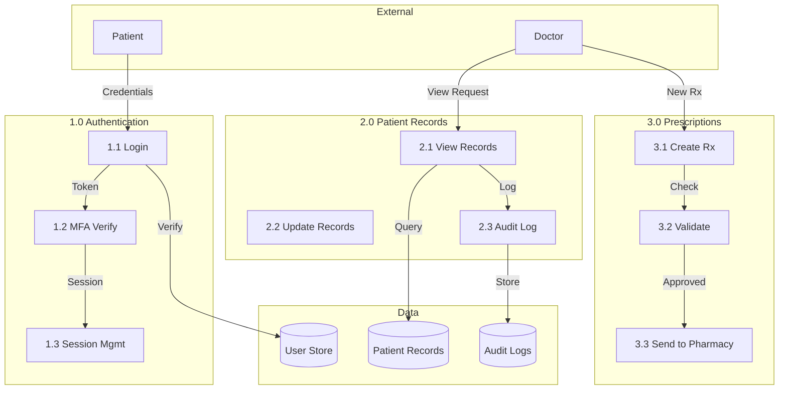

# Level 1 Data Flow Diagram

## Data Classification

The following table identifies the sensitivity of the primary data processed within Solaris Care Connect 360 and the minimum security controls required to protect each data type.

| Data Type             | Classification | Encryption Required                           | Logging Required                           |
| --------------------- | -------------- | --------------------------------------------- | ------------------------------------------ |
| Patient Records       | PHI – Critical | Yes (AES-256 at rest, TLS 1.2+ in transit)    | Yes – Full audit logging                   |
| Login Credentials     | PII – High     | Yes (bcrypt password hashing, TLS in transit) | Yes – Authentication and access logs       |
| Session Tokens        | Sensitive      | Yes (Signed JWT, HTTPS Only, Secure Cookies)  | Yes – Session creation and validation logs |
| Audit Logs            | Internal       | Yes (AES-256 at rest)                         | N/A                                        |
| Lab Results           | PHI – Critical | Yes (AES-256, TLS 1.2+)                       | Yes – Full audit logging                   |
| Prescription Data     | PHI – Critical | Yes (AES-256, TLS 1.2+)                       | Yes – Full audit logging                   |
| Insurance Information | PII – High     | Yes (AES-256, TLS 1.2+)                       | Yes – Access and transaction logs          |
| Patient Demographics  | PII – High     | Yes (AES-256, TLS 1.2+)                       | Yes – Access logging                       |

### Key Security Considerations

* **Protected Health Information (PHI)** requires the highest level of protection due to regulatory requirements such as HIPAA.
* All PHI and PII must be encrypted both **in transit** and **at rest**.
* Authentication events, data access, and administrative actions must be logged to support auditing, compliance, and incident investigations.
* Session tokens must be cryptographically signed and transmitted only over secure HTTPS connections.
* Audit logs must be protected from unauthorized modification and retained according to organizational and regulatory policies.
